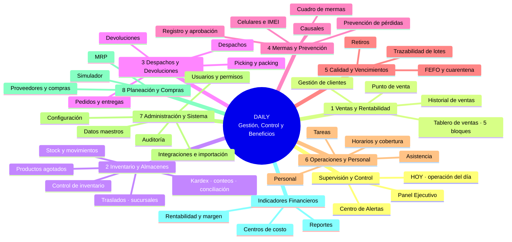

# 20.02 · Mapa de DAILY Retail

**DAILY — Gestión, Control y Beneficios.** El mismo orden del menú lateral (`helpers/DairyNavigation.php`) y del Mapa del Sistema (`/system-map`).

## Ramas

Términos: **Gestión** = registrar y operar (crear, aprobar, mover). **Integraciones** = intercambio con sistemas externos (POS, ERP, importación CSV/Excel). **Alertas** = avisos automáticos con responsable y cierre. **Usuarios** = cuentas, roles y permisos.

| Rama | Objetivo | Procesos principales | Indicadores prioritarios | Funciones operativas | Depende de | Alimenta a |
|---|---|---|---|---|---|---|
| Supervisión y Control | Ver en un minuto qué requiere decisión hoy. | Revisión diaria, atención de alertas, seguimiento ejecutivo. | Ventas netas vs. meta, margen bruto, merma/ventas, disponibilidad del surtido, asistencia. | HOY, Centro de Alertas, Panel Ejecutivo. | Todos los módulos (lee `DailyMetricsService`). | Decisiones y tareas a cada módulo. |
| 1. Ventas y Rentabilidad | Vender más y con margen. | Venta en POS, análisis comercial, gestión de clientes. | Ventas netas y evolución, comparación de fin de semana y año anterior, ventas por hora trabajada, Top 5, tráfico (cuando exista sensor). | Tablero de 5 bloques, historial, POS, clientes, precios y promociones. | Inventario (stock para vender), Personal (horas), Datos maestros (precios). | Inventario (salida FEFO), Mermas (rebajas), Indicadores Financieros. |
| 2. Inventario y Almacenes | Tener el producto correcto, en la tienda correcta, con stock confiable. | Recepción, movimientos, traslados, conteos, conciliación. | Productos agotados, disponibilidad del surtido, bajo mínimo, valor de inventario, diferencias de conteo. | Stock, Agotados (SKU), Control de inventario, Kardex, Conteos, Conciliación, Traslados. | Compras (entradas), Ventas (salidas), Mermas (bajas). | Ventas, Despachos, Planeación (reposición). |
| 3. Despachos y Devoluciones | Entregar completo y a tiempo; recuperar lo devuelto. | Pedido, picking, empaque, despacho, devolución e inspección. | Pedidos a tiempo, pedidos atrasados, exactitud de preparación, devoluciones. | Pedidos y entregas, Picking, Despachos, Devoluciones. | Inventario (reservas), Clientes. | Inventario (reingreso), Mermas (destino sanitario). |
| 4. Mermas y Prevención | Reducir pérdidas conocidas y desconocidas. | Registro con evidencia, aprobación, causales, investigaciones, control de activos y celulares. | Merma aprobada ($ y % sobre ventas), pendientes de aprobación, casos abiertos, diferencias sensibles. | Cuadro de mermas, Registro, Aprobaciones, Causales, Prevención de pérdidas, Celulares. | Inventario, Calidad (vencidos), Ventas (base %). | Inventario (baja), Indicadores Financieros. |
| 5. Calidad y Vencimientos | Vender solo producto apto. | FEFO, cuarentena, cadena de frío, retiros. | Lotes por vencer y vencidos, productos en cuarentena, excursiones de temperatura. | Calidad y vencimientos, Trazabilidad, Retiros. | Inventario (lotes), Proveedores. | Mermas, Ventas (rebajas FEFO). |
| 6. Operaciones y Personal | Tener la gente necesaria en la hora necesaria. | Programación de turnos, asistencia, tareas. | Horas programadas vs. presentes, cobertura, asistencia, ventas por hora trabajada. | Personal, Horarios, Asistencia, Tareas, Productividad. | Ventas (demanda por hora). | Ventas (productividad), Supervisión. |
| 7. Administración y Sistema | Configurar DAILY para cada empresa y protegerlo. | Parámetros, usuarios y permisos, datos maestros, integraciones, auditoría. | Usuarios activos, importaciones fallidas, eventos de auditoría. | Configuración, Usuarios y permisos, Datos maestros (departamentos, categorías, productos), Importar/Exportar, Auditoría. | — | Todos (catálogos, permisos). |
| 8. Planeación y Compras | Reponer a tiempo sin sobrestock. | MRP, órdenes de compra, recepción, evaluación de proveedores. | Compras atrasadas, cumplimiento OTIF, cobertura en días. | MRP, Proveedores y compras, Simulador. | Inventario, Ventas (demanda). | Inventario (entradas). |
| Indicadores Financieros | Leer la rentabilidad transversal. | Margen, centros de costo, informes. | Margen diario, mensual y acumulado; margen por departamento; presupuesto. | Rentabilidad y margen, Centros de costo, Reportes, Arturito IA. | Ventas, Mermas, Inventario. | Supervisión. |

## Identidad (Fase 10)

- Símbolo: la aplicación ya usa el monograma **«D» en placa redondeada** (`public/img/icon.svg`, logotipo SVG en el encabezado). No se encontró ninguna cabeza de ganado en el código; los únicos íconos `fa-cow` (departamentos Carne y Lácteos en Mermas) se reemplazaron por `fa-drumstick-bite` y `fa-cheese`. Si la cabeza de ganado aparece en materiales externos (mapa mental anterior, presentaciones), debe sustituirse por este monograma.
- Mensaje: **DAILY — Gestión, Control y Beneficios** (pantalla de inicio de sesión y título del logotipo). El mensaje «Gestión, Control y Crecimiento» no existe en el código.
- Colores, tipografía y componentes: sin cambios.
