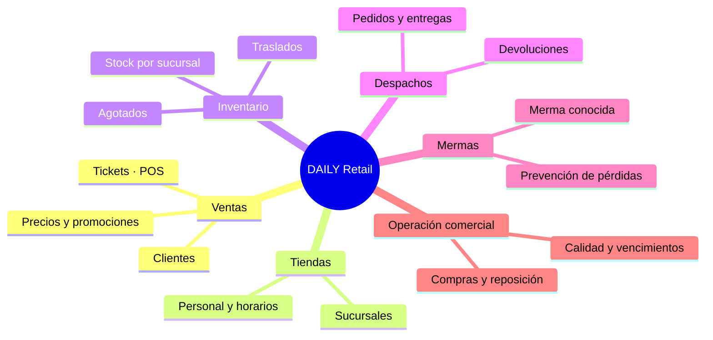
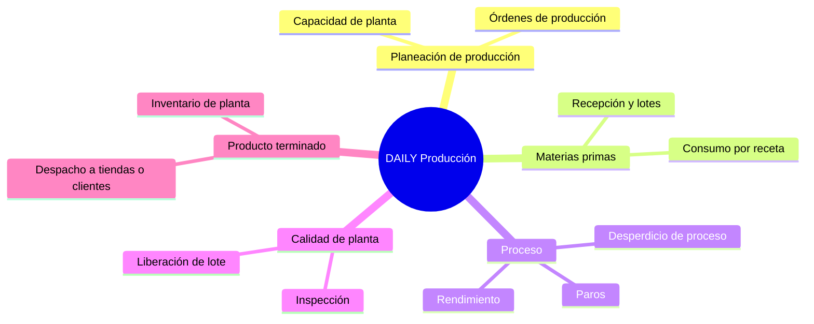

# 20.03 · DAILY Retail y DAILY Producción (separación conceptual)

Prioridad actual: **Retail**. Producción solo se define aquí como concepto; no se construye una segunda aplicación ni se mezclan sus métricas con las de tienda.

## DAILY Retail (lo que existe hoy)

Unidad de análisis: **tienda × departamento × producto × día/hora**. Indicadores: ventas netas, margen bruto, ticket promedio, agotados, merma/ventas, ventas por hora trabajada, pedidos a tiempo.

## DAILY Producción (por definir)

Unidad de análisis: **planta × línea × orden × turno**. Indicadores candidatos (a validar con un cliente productor): rendimiento de materia prima, OEE, desperdicio de proceso, cumplimiento del plan, costo por unidad producida. Ninguno se calcula ni se muestra hoy.

## Reglas de separación

1. Ninguna métrica de producción aparece en tableros retail (y al revés). La merma de tienda (`waste_records`) no es desperdicio de proceso.
2. El catálogo de productos y la trazabilidad de lotes son comunes; el «producto terminado» de Producción entra a Retail como recepción en una sucursal (traslado o compra interna).
3. Las clasificaciones (departamentos, categorías) siguen siendo configurables por empresa.

## Propuesta de arquitectura futura (no implementada)

| Capa | Retail (hoy) | Producción (futuro) |
|---|---|---|
| Datos | Tablas actuales (`sales`, `stock`, `waste_records`, `employee_shifts`…) | Esquema propio (`production_orders`, `production_runs`, `bom_consumption`, `line_stops`) en la misma base o en una base aparte por empresa. |
| Servicios | `DailyMetricsService`, `SalesDashboardService`, `StockoutService` | `ProductionMetricsService` independiente. |
| Navegación | `DairyNavigation::Categories()` | Una segunda definición de menú activada por una bandera de empresa (`company.modules = retail, production`). |
| Integración | Traslado/recepción de producto terminado | Publica «lote liberado» en el bus de eventos existente (`UnifiedInventoryEventService`). |
| Fuente de datos | Demostración (`is_demo`, semilla `DailyCompanySeedService`) o datos reales del cliente | Igual: cada registro sabe si es simulado. |

## Datos simulados vs. reales (Fase 11)

- Fuente compartida: `DailyMetricsService` (HOY, Panel, Ventas, Agotados) — misma fórmula y mismo filtro producen la misma cifra. Prueba: `tests/dairy/test_shared_filters.php` (75 verificaciones).
- Una venta descuenta inventario (FEFO) en la misma transacción (`SalesService::CreateSale`), así que Ventas, Stock y Agotados quedan coherentes.
- La empresa de ejemplo marca productos y sucursales de demostración (`is_demo`, nombres «(DEMO)»). Recomendación: agregar `companies.data_mode = 'demo' | 'real'` y mostrar una etiqueta «Datos de demostración» en el encabezado cuando aplique.
- Integración con bases empresariales: el punto de entrada existente es la importación (`/data-import`) y la ingesta POS (`pos_ingest_batches`, `pos_external_sales`). No hay conectores a ERP configurados; no se inventó ninguno.
